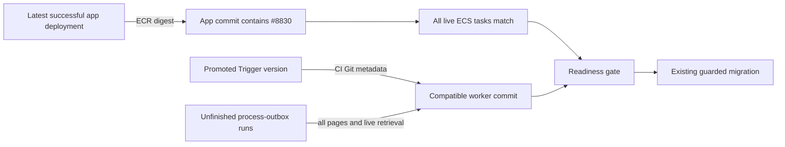

# Project membership contraction readiness

`check-project-rollout.py` replaces #8590's manually populated image-digest variables. This is a Project-specific contraction gate, not a requirement for every migration. The database model, migration order, and supported rollback release remain unchanged: #8830 or a compatible descendant must serve before the connector is retired.

The migration workflow only invokes it while `project-contract-required.ts` says contraction evidence is still needed. After the completion receipt and contracted schema are verified, subsequent deployments skip it.

## Evidence

1. Discover the latest app CodePipeline execution and require success. Its ECR source supplies the digest; no operator chooses one.
2. Resolve that digest in the existing `ECR_APP` repository to exactly one full commit tag. Require that commit to descend from #8830 (`34925988ee6720d09cc80f537faab6155875984e`). This relies on the repository's CI SHA-tag build provenance and the supported no-incompatible-revert release policy.
3. Require the ECS service to be stable and every live task—including tasks whose desired status is STOPPED but which have not actually stopped—to run that digest.
4. Exchange the existing CI `TRIGGER_ACCESS_TOKEN` for a short-lived token scoped to the selected project's staging or production environment, with only `read:runs` and `read:deployments`. Require the promoted worker's Git metadata to identify this repository's CI and a compatible commit.
5. Paginate unfinished `process-outbox` runs without a recent-only date window. Retrieve each run's current state to avoid stale list entries. Queued, pending-version, executing, retrying, frozen, waiting, and delayed runs are included. Every unfinished run must have a bound, attributable compatible version; missing evidence blocks the gate.
6. Recheck the promoted worker and ECS deployment to detect changes during inspection.

`process-outbox` is a concrete membership writer: its lazy handlers invoke enterprise workspace moves, owner claims, and organization membership reconciliation through `lib/billing/enterprise-provisioning.ts`, `lib/billing/enterprise-owner-claim.ts`, `lib/workspaces/admin-move.ts`, and `lib/billing/organizations/membership.ts`. Those paths create or reassign Project membership. Its inline backend executes inside the app and is covered by ECS retirement.

Workflow execution, content copy, search indexing, and lifecycle email are not independently required to stop. Merely importing shared billing or workspace helpers does not make a task a membership writer. External Mothership callers enter the serving Sim application; their existence alone does not establish a direct connector reader. Reassess this task inventory if another background entry point gains direct membership access.

## Validation and operation

Use the existing `migrate` workflow's `verify_only=true` dispatch input with `environment=staging` to run the real read-only preflight before merging. This path never reaches the database migration step. Normal CI calls retain migration behavior. The workflow uses existing AWS, ECR, and Trigger secrets; it does not create readiness variables or credentials.

An API denial, missing provenance, unknown version, incomplete pagination, unfinished incompatible run, or deployment race fails the gate with an error. Resolve the reported evidence/access problem and run a fresh verification. Do not acknowledge it with an override. Never cancel worker runs automatically to satisfy readiness.

After a successful staging migration, run the existing external before/after fixture kit before claiming the rollout verified. Production requires its own live gate when deployed; staging success is not production evidence.
